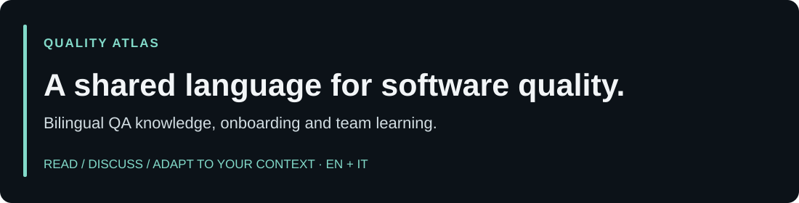

# Quality Atlas



Quality Atlas is an open, bilingual knowledge base for software quality assurance and testing. It supports onboarding, knowledge transfer, self-study, interview preparation, and team learning from foundation to advanced level.

Quality Atlas è una knowledge base aperta e bilingue dedicata alla quality assurance e al software testing. Supporta onboarding, knowledge transfer, studio autonomo, preparazione ai colloqui e apprendimento di team, dal livello base a quello avanzato.

<p><a href="docs/00-start/learning-paths.md"></a> <a href="https://www.linkedin.com/in/manoj-rollo/"></a></p>

## Find a useful first read / Scegli una prima lettura utile

| Your question / La tua domanda | Read / Leggi | Useful result / Risultato utile |
| --- | --- | --- |
| What do we mean by risk and coverage? / Cosa intendiamo per rischio e copertura? | [Risk-based strategy](docs/20-intermediate/risk-based-strategy.md) | Terms to align before planning / Termini da allineare prima di pianificare |
| What evidence belongs in a release discussion? / Quali evidenze servono per parlare del rilascio? | [Release readiness](docs/40-playbooks/release-readiness.md) | Questions for the accountable owners / Domande per i responsabili della decisione |
| What should a performance discussion include? / Cosa includere nel confronto sulle performance? | [Performance and reliability](docs/30-advanced/performance-reliability.md) | Concepts to clarify before defining workloads / Concetti da chiarire prima di definire i carichi |
| How can we make onboarding more coherent? / Come rendere più coerente l'onboarding? | [Learning paths](docs/00-start/learning-paths.md) | A reading route to adapt to the team's needs / Un percorso da adattare al team |

These notes support learning; applying them to a live SAP, ServiceNow, Salesforce, Dynamics 365 or web-platform release needs product evidence and accountable owners. / Le note supportano l'apprendimento; applicarle a un rilascio reale SAP, ServiceNow, Salesforce, Dynamics 365 o web richiede evidenze sul prodotto e responsabili della decisione.

For assessment, delivery support or a B2B partnership, explore [Quality Engineering 360](https://github.com/mr-jonam/quality-engineering-360#choose-a-starting-point), then [discuss your QA challenge](https://www.linkedin.com/in/manoj-rollo/). Share the topic you read, the decision ahead and the uncertainty to investigate. / Per assessment, supporto operativo o partnership B2B, esplora [Quality Engineering 360 in italiano](https://github.com/mr-jonam/quality-engineering-360/blob/main/README.it.md#scegliere-da-dove-partire), poi [confrontiamoci](https://www.linkedin.com/in/manoj-rollo/): indica lettura, decisione e dubbio da approfondire. Perimetro e condizioni si concordano separatamente.

## Start here / Inizia qui

- Open [`docs/00-start/home.md`](docs/00-start/home.md) in GitHub or Obsidian.
- Use the independent [`QA Engineer roadmap`](docs/00-start/qa-engineer-roadmap.md) for a sequenced path inspired by common public curricula.
- Follow a role-based route in [`docs/00-start/learning-paths.md`](docs/00-start/learning-paths.md).
- Copy and adapt the worksheets in [`templates/`](templates/).
- Run the web reader with Node.js or Docker.

## Run the web reader / Avvia il sito

Node.js 20 or newer:

```bash
npm run dev
```

Then open `http://localhost:4173`.

Docker:

```bash
docker compose up --build
```

The reader indexes Markdown at startup and provides navigation, filters, bilingual search, reading progress, dark mode, and direct links to each source note. No package installation is required.

## Use with Obsidian / Usa con Obsidian

1. Clone or download the repository.
2. In Obsidian, choose **Open folder as vault**.
3. Select the repository root.
4. Start from `docs/00-start/home.md`.

The vault uses plain Markdown, YAML frontmatter, folders, tags, and wiki links. The committed Obsidian settings are intentionally minimal and contain no personal workspace state.

## Scope and safety / Ambito e sicurezza

The material is vendor-neutral and based on broadly available testing knowledge. Examples use fictional, generic systems. Do not contribute confidential information, credentials, personal data, customer names, internal architecture, or proprietary procedures. This repository is educational material, not a substitute for a context-specific quality, legal, security, or compliance review.

## Contributing

Read [`CONTRIBUTING.md`](CONTRIBUTING.md). Run `npm run check` before opening a pull request.

## Language editions / Edizioni linguistiche

The `main` branch is bilingual (English and Italian). Complete monolingual editions are available on dedicated branches:

Il branch `main` è bilingue (inglese e italiano). Le edizioni monolingua complete sono disponibili su branch dedicati:

- [English](https://github.com/mr-jonam/quality-atlas/tree/lang/en)
- [Italiano](https://github.com/mr-jonam/quality-atlas/tree/lang/it)
- [Français](https://github.com/mr-jonam/quality-atlas/tree/lang/fr)
- [Español](https://github.com/mr-jonam/quality-atlas/tree/lang/es)
- [Deutsch](https://github.com/mr-jonam/quality-atlas/tree/lang/de)

## Support / Sostieni il progetto

If Quality Atlas helps your learning or onboarding, you can support its maintenance through [GitHub Sponsors](https://github.com/sponsors/mr-jonam). Donations are optional and do not influence the educational content.

Se Quality Atlas è utile per apprendimento o onboarding, puoi sostenerne la manutenzione tramite [GitHub Sponsors](https://github.com/sponsors/mr-jonam). Le donazioni sono facoltative e non influenzano i contenuti educativi.

GitHub also displays the **Sponsor** button using [`.github/FUNDING.yml`](.github/FUNDING.yml).

## License

- Documentation and templates: [CC BY 4.0](LICENSES/CC-BY-4.0.txt).
- Web reader, scripts, and configuration code: [MIT](LICENSES/MIT.txt).

See [`LICENSE`](LICENSE), [`NOTICE`](NOTICE), and [`LICENSE-DECISION.md`](LICENSE-DECISION.md) for scope and rationale.
